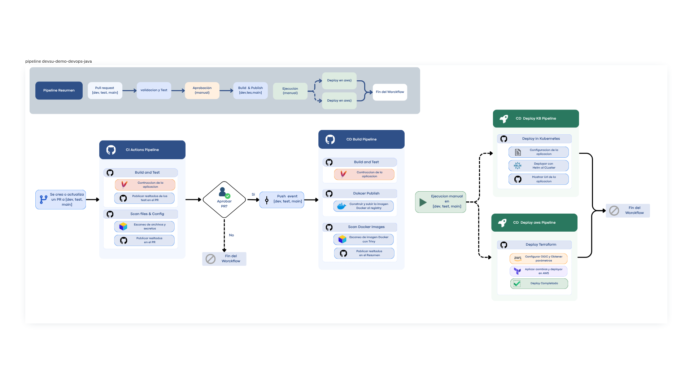

# Demo DevOps Java

Microservicio de usuarios (Spring Boot) con infraestructura en AWS ECS, despliegue alternativo en Kubernetes on-premise y pipelines CI/CD en GitHub Actions.

Uso local y API completa: ver [DEMO.md](DEMO.md).

## Infraestructura

Todo lo declarado está en `IaC/` (Terraform, AWS `us-east-1`) y `kubernetes/` (chart Helm `ms-template`).

- **AWS ECS (Terraform):** declara `aws_lb_target_group` (HTTP, `target_type ip`, health-check), `aws_lb_listener_rule` (por `path_pattern`), `aws_ecs_task_definition` (Fargate) y `aws_ecs_service` (`desired 2`). VPC, ALB, clúster, subredes, SG y rol de ejecución son preexistentes y se consumen por `terraform_remote_state` (S3) — no se crean aquí. Estado por rama (`<rama>_terraform.tfstate`).
  - Nota : esta solucion depende del infraestrcutura [aws-microservicios-ecs](https://github.com/codeparceorg/infra-microservice-aws) 
- **Kubernetes (Helm):** plantillas `Deployment` (réplicas 2, puerto 8000) + `Service` ClusterIP (`:80 → 8000`) + `IngressRoute` Traefik (`Host + PathPrefix`) + `HPA` (2–4, CPU 60%) + `ConfigMap` (desde fichero `.env`, ausente en el repo). Namespace `sis-<rama>-ms`, imagen `<org>/<repo>:<sha>`. Secret solo si `secret.enabled=true` (por defecto `false`).

Diagrama interactivo: [docs/infraestructura.html](docs/infraestructura.html) · [docs/kubernetes.html](docs/kubernetes.html)

## Pipeline CI/CD

Workflows independientes en `.github/workflows/` (sin dependencias entre ellos, sin aprobaciones configuradas). Todos los escaneos Trivy usan `exit-code 0` (informan, no bloquean).

| Workflow | Evento | Etapas |
|---|---|---|
| CI Actions Pipeline | `pull_request` a `dev, test, main` + manual | Build Maven con tests ∥ Trivy repo (filesystem + IaC/configs) |
| CD Build Pipeline | `push` a `dev, test, main` | Build Maven (sin tests) → publica imagen Docker (tag = sha) → Trivy a la imagen |
| CD deploy Kubernetes | Manual (`dev, test, main`) | `helm upgrade --install` on-premise (runner `kubernetes`). Nota: el job declara `needs: docker-publish`, job que ya no existe en este archivo |
| CD deploy AWS | Manual (`dev, test, main`) | OIDC → parámetros → `terraform init/apply` en `IaC/` |
| Pipeline env & connection | Manual | Diagnóstico de variables, contexto y OIDC |

*Nota: el diagrama general es el existente en el repo; para mejor visualziación revisar el [Flujo del pipeline .pdf](docs/devsu-demo-devops-java.pdf)*

## Despliegue

- **AWS ECS:** `cd-deploy-cloud.yml` (manual) aplica Terraform contra `dev`, `test` o `main`.
- **Kubernetes on-premise:** `cd-deploy-kb.yml` (manual) renderiza `values.template` con `envsubst` y despliega con Helm en `sis-<rama>-ms`; expone `http://microservicio.<ns>.lab/api/users`.
- La app escucha en el puerto `8000` (`/api/users`); imagen `eclipse-temurin:17-jre-alpine` con healthcheck.

## Tecnologías

Java 17 · Spring Boot 3.0.5 · Maven · Docker · Terraform (~6.0, AWS) · Helm / Traefik · Trivy · GitHub Actions (runners `ubuntu-latest` y `kubernetes`).
